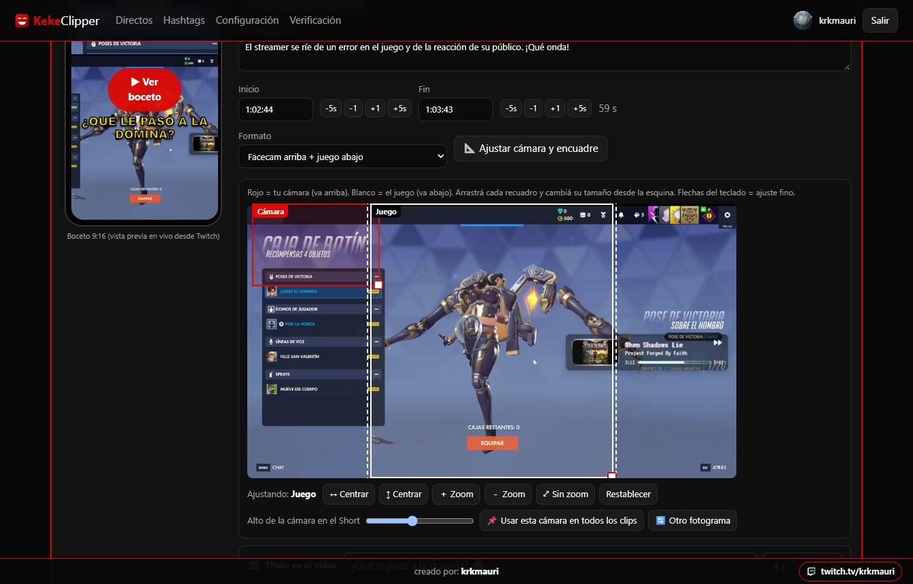

# KekeClipper v1.1.0

## Novedades
- **📐 Ajustar cámara y encuadre** en cada clip, a mano, sobre un fotograma real del clip:
  - **Facecam + juego**: recuadro rojo = tu cámara (arriba), blanco = el juego (abajo). Elegís cuánto alto ocupa la cámara en el Short.
  - **Recorte** y **Fondo desenfocado**: el recuadro es lo que se ve; achicalo para hacer zoom.
  - Arrastrar para mover, esquina para agrandar o achicar, flechas del teclado para el ajuste fino.
  - Botones **↔ / ↕ Centrar**, **＋ / － Zoom**, **Sin zoom** y **Restablecer**.
  - **📌 Usar esta cámara en todos los clips** y **🔄 Otro fotograma** si la cámara no se ve en uno.

- El boceto del teléfono muestra el encuadre al instante y el video sale igual (la imagen nunca se deforma).

## Actualizar desde v1.0.0
Seguí los pasos de [docs/INSTALAR.md](docs/INSTALAR.md): descomprimí el zip en la carpeta que **contiene** tu carpeta KekeClipper y reemplazá los archivos. Tu carpeta data no se toca.

---

# KekeClipper v1.0.0

Primera versión. Encuentra los momentos más graciosos de tus directos de Twitch y los convierte en Shorts.

## Qué hace
- **Analiza tus VODs sin descargarlos**: lee el chat, escucha el audio por streaming, transcribe con Whisper (en tu PC) y una IA local gratis (Ollama) entiende el humor latino — Argentina, Uruguay, Perú, Chile, México.
- **Shorts 9:16** (1080×1920) con boceto en formato teléfono antes de generarlos.
- **Título y subtítulos opcionales y editables**: prendelos o apagalos, corregí cada línea, cambiá tiempos, tamaño y color, y arrastralos en el boceto.
- **Resumen para YouTube** de hasta 10 minutos: en orden cronológico, cortes en pausas del habla y fundidos cortos, con título, descripción y capítulos.
- **Subida sin tokens**: copia el texto y abre la página de subida de YouTube, Instagram o TikTok.
- **Hashtags** de Overwatch y del streaming latino.

## Instalación
1. Descargá **KekeClipper-v1.0.0-windows.zip** y descomprimilo en una carpeta (por ejemplo, `Documentos\KekeClipper`).
2. Doble clic en **KekeClipper.exe**.
   - Si no tenés **Node.js**, la app ofrece instalarlo.
   - La primera vez prepara sus componentes (1-2 min, necesita internet).
3. La app verifica FFmpeg, Ollama y los modelos. Lo que falte se instala con un botón (**Instalar todo lo que falta**). El modelo de humor pesa ~5 GB.
4. Iniciá sesión con Twitch (código en twitch.tv/activate), elegí un directo y tocá **Analizar**.

Mirá **KekeClipper_Tutorial.mp4** para ver todo el recorrido.

## Requisitos
- Windows 10 u 11 (64 bits).
- 16 GB de RAM recomendado para la IA local; ~8 GB libres en disco.
- Conexión a internet.

---
creado por: **krkmauri** · [twitch.tv/krkmauri](https://www.twitch.tv/krkmauri)
