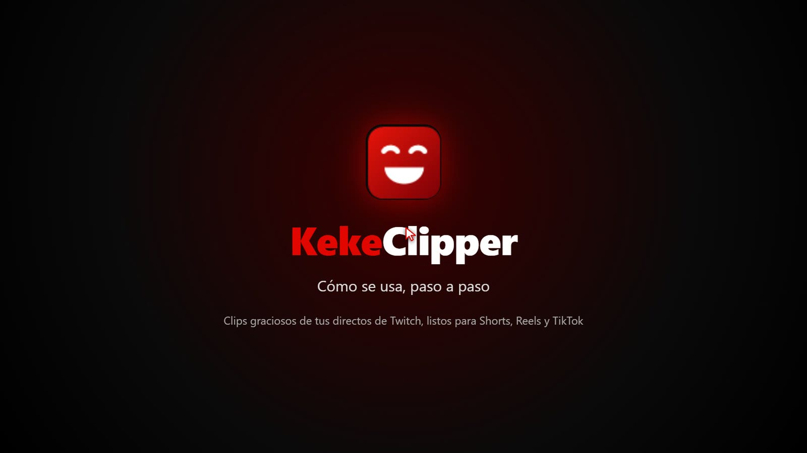
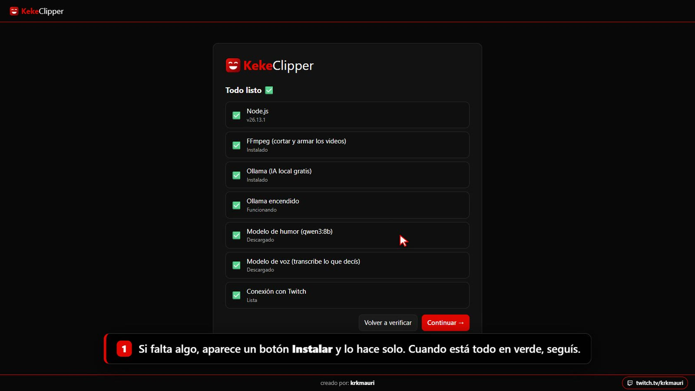
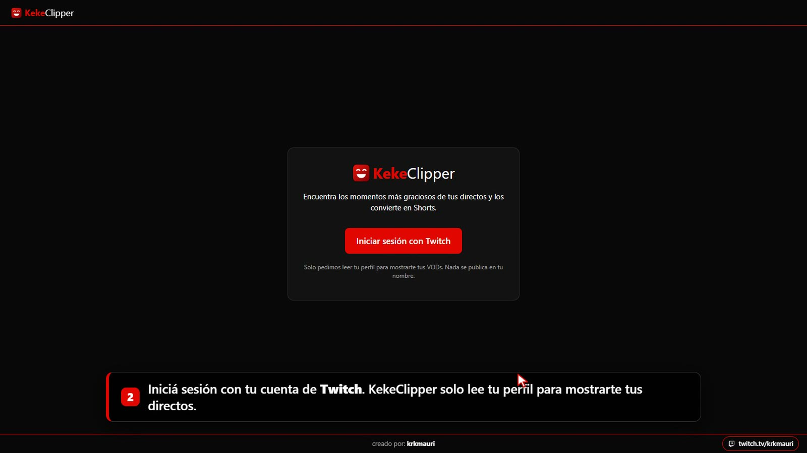
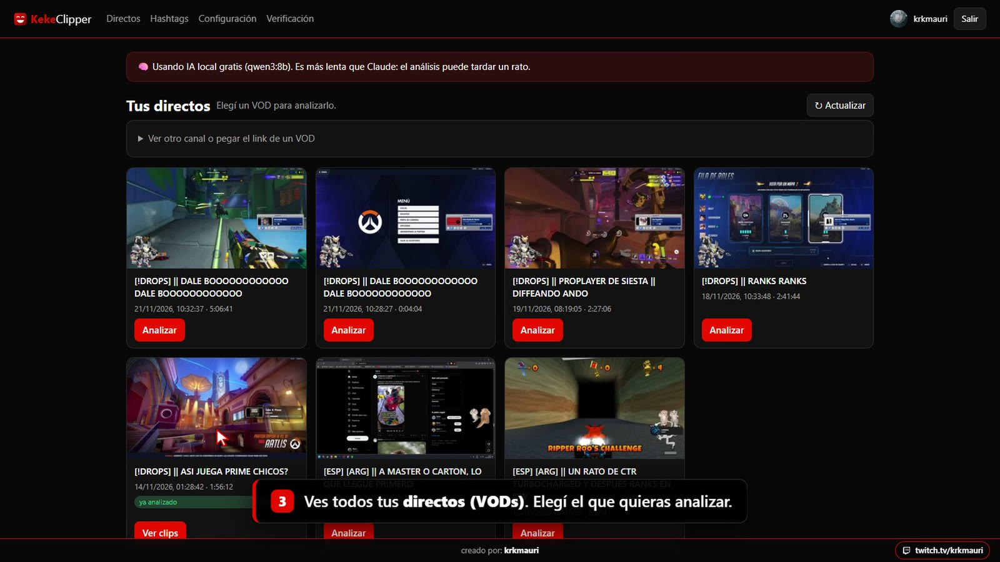
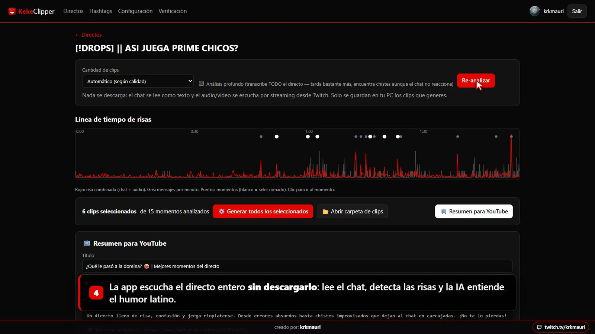
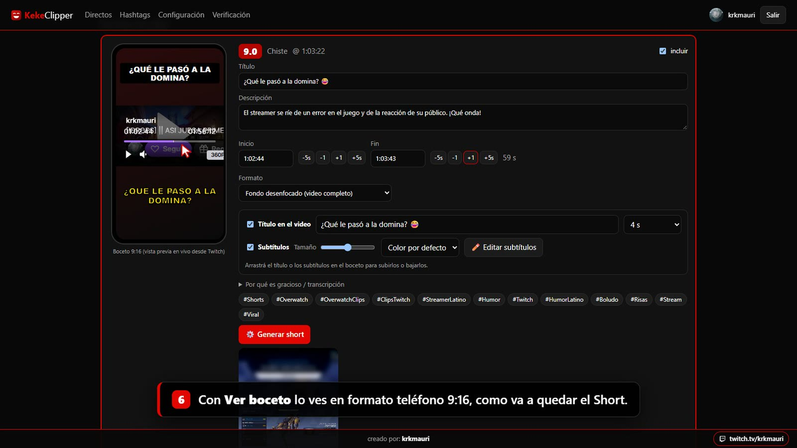
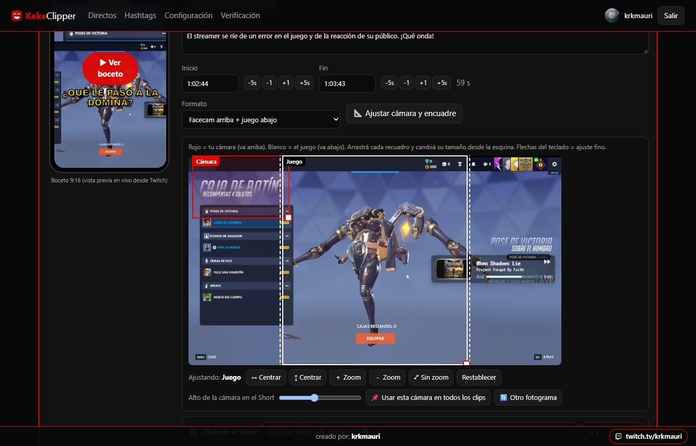
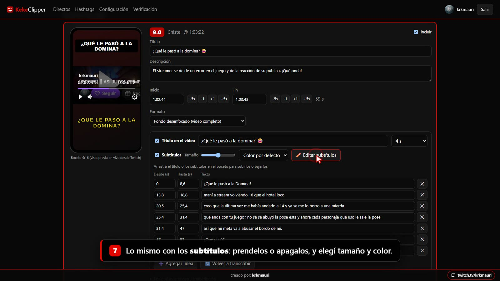
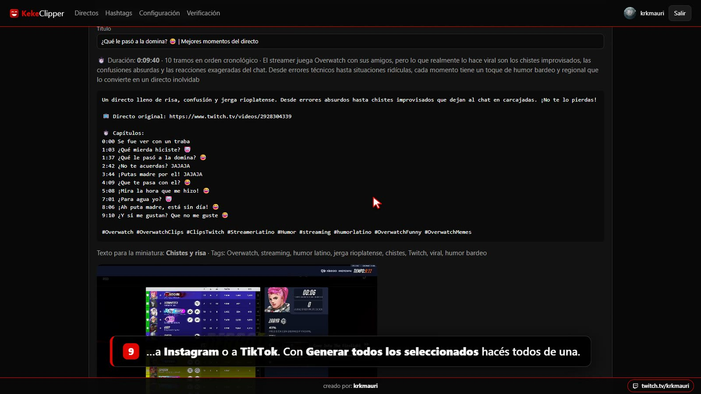

# 🎬 KekeClipper

App de Windows que se conecta a tu Twitch, escucha tus directos completos, encuentra los momentos más graciosos (humor latino: Argentina, Uruguay, Perú, Chile, México…) y los convierte en **Shorts 9:16** con subtítulos. También arma el **resumen del directo** para YouTube (máximo 10 minutos).

## Capturas

**1. Verificación de complementos al abrir**

**2. Login con Twitch**

**3. Tus directos**

**4. Análisis y línea de tiempo de risas**

**5. Boceto 9:16, título y subtítulos**

**Ajustar cámara y encuadre**

**6. Editor de subtítulos**

**7. Resumen para YouTube con capítulos**

## Cómo arrancar
> **¿Actualizando desde otra versión?** Seguí [docs/INSTALAR.md](docs/INSTALAR.md) para no perder tu sesión ni tus análisis.

1. Doble clic en **`KekeClipper.exe`**. Se abre como una app normal de Windows (ventana propia, ícono en la barra de tareas).
   - Si falta **Node.js**, la app ofrece instalarlo. La primera vez prepara sus componentes (1-2 min).
2. **Verificación**: al abrir, revisa que esté todo instalado — FFmpeg, Ollama (IA local gratis), el modelo de humor y el de voz. Si falta algo, tocá **Instalar** o **Instalar todo lo que falta** (usa `winget`, el instalador de Windows).
3. **Iniciá sesión con Twitch**: la app te da un código y lo confirmás en twitch.tv/activate. Solo lee tu perfil para listar tus VODs.
4. Elegí un directo y tocá **Analizar**.

> ¿Sin el .exe? `iniciar.bat` abre la misma app en el navegador. Para volver a compilar el .exe: `powershell -ExecutionPolicy Bypass -File launcher\build.ps1` (usa el compilador que ya trae Windows).

## Qué hace, paso a paso
1. **Chat** del VOD (solo texto): detecta picos de `JAJAJA`, `jsjsjs`, `KEKW`, `LPM`, `nmms`, `me meo`, `csm`, 💀😂…
2. **Audio por streaming** (no baja la VOD): energía + patrón rítmico de risa.
3. Para cada pico, **Whisper local** transcribe la ventana y la **IA** (Ollama local gratis, o Claude si cargás una API key) analiza si fue un chiste hecho en el momento, una reacción, un fail, un bardeo… Si el chiste empezó antes, vuelve a escuchar con más contexto.
4. Puntúa 0-10 y elige **la cantidad de clips según la calidad** (o la que vos digas).
5. **Bocetos**: cada clip se previsualiza en un teléfono 9:16 con el reproductor de Twitch. Ajustás inicio/fin, título, descripción y formato.
6. **📐 Ajustar cámara y encuadre** (en cada clip): sobre un fotograma real del clip movés y agrandás recuadros —
   - **Facecam + juego**: el recuadro rojo es tu cámara (va arriba) y el blanco el juego (va abajo). Elegís cuánto alto ocupa la cámara en el Short.
   - **Recorte** y **Fondo desenfocado**: el recuadro es lo que se ve; achicalo para hacer zoom.
   - Botones **↔ / ↕ Centrar**, **＋ / － Zoom**, **Sin zoom**, **Restablecer**, flechas del teclado para el ajuste fino y **📌 Usar esta cámara en todos los clips**.
   - El boceto del teléfono muestra el resultado al instante y el video sale igual.
7. **Título y subtítulos a tu gusto**:
   - Activá o desactivá el **título** del video y los **subtítulos** por separado.
   - Editá el texto del título y cuánto dura en pantalla (4 s, 8 s o todo el clip).
   - **✏️ Editar subtítulos**: corregí cada línea, cambiá sus tiempos, borrá o agregá líneas.
   - **Arrastrá** el título o los subtítulos en el boceto para subirlos o bajarlos (doble clic = posición original). Tamaño y color con los controles.
8. **Generar short**: baja *solo ese tramo*, lo pasa a 1080×1920 con volumen normalizado → `Descargas\ClipsTwitch\…` junto a un `.txt` con títulos, descripciones y hashtags.
9. **Subir**: copia el texto, abre la carpeta con el video seleccionado y abre la página de subida de YouTube / Instagram / TikTok en tu navegador (sin tokens: arrastrás el archivo).
10. **Resumen para YouTube** (máx. 10 min): la IA elige los mejores momentos y los que dan contexto, se arman en **orden cronológico** para que se entienda, los cortes caen en **pausas del habla** (no a mitad de frase) y se unen con un fundido corto que no frena el ritmo. Incluye título, descripción y capítulos.
11. **Hashtags**: tendencias del día de Overwatch + streaming latino (con Claude busca en la web; con la IA local usa la lista base de la temporada).

**Análisis profundo**: transcribe todo el directo para encontrar chistes aunque el chat no reaccione. Tarda bastante más.

## Notas
- El chat y la reproducción usan los mismos endpoints que el reproductor web de Twitch (como yt-dlp/streamlink). Twitch no los documenta, así que podrían cambiar.
- Todo queda en `data/` (config, sesión, análisis) y en tu carpeta de clips. `data/` está en `.gitignore`: nunca se sube al repo.
- La ventana usa **WebView2**, el motor web que ya trae Windows 10/11 (las DLL oficiales de Microsoft están en `launcher/lib`).
